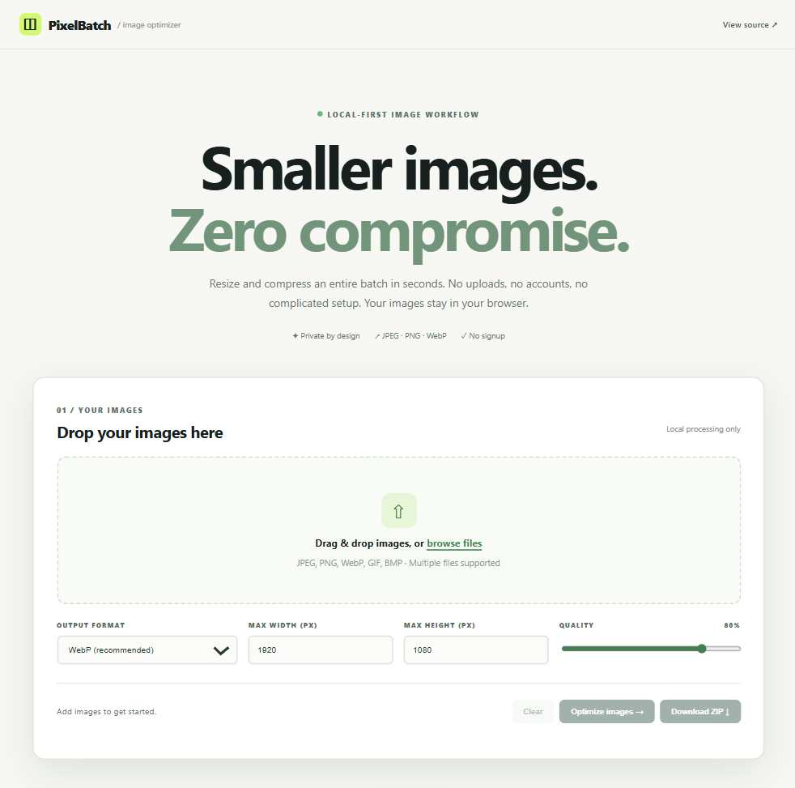

# PixelBatch — Batch Image Optimizer

**Optimize multiple images in seconds. Private, lightweight, and easy to use.**

[**Live Website**](https://chandana-galgali.github.io/Batch-Image-Optimizer/) · [**MIT License**](LICENSE)



PixelBatch is a batch image optimizer that works in your browser or from the command line. Resize, compress, and convert images without uploading them to a server.

## Features

- **Batch processing** — optimize multiple images together.
- **Local and private** — images stay on your device.
- **Flexible output** — export JPEG, PNG, or WebP.
- **Smart resizing** — preserve aspect ratio without upscaling.
- **Easy downloads** — download processed browser images in a ZIP.
- **Python CLI** — automate optimization for local folders.

## Use the web app

Open the [live website](https://chandana-galgali.github.io/Batch-Image-Optimizer/) or launch [`web/index.html`](web/index.html) locally. Drop in images, choose your settings, click **Optimize images**, and download the ZIP.

## Use the Python CLI

Requires Python 3.10+.

```bash
python -m pip install -r requirements.txt
```

Add your images to `images/input/`, then run:

```bash
python image_optimizer.py --max-width 1920 --max-height 1080 --quality 75
```

Optimized images are saved in `images/output/`.

To use custom directories and output format:

```bash
python image_optimizer.py --input ./photos --output ./optimized --format webp --max-width 1200 --max-height 1200 --quality 82
```

### CLI options

| Option | Default | Description |
| --- | --- | --- |
| `--input` | `images/input` | Input directory |
| `--output` | `images/output` | Output directory |
| `--max-width` | `1920` | Maximum width in pixels |
| `--max-height` | `1080` | Maximum height in pixels |
| `--quality` | `75` | JPEG/WebP quality (1–100) |
| `--format` | `jpeg` | `jpeg`, `png`, or `webp` |

## Project structure

```text
Batch-Image-Optimizer/
├── web/                    # Browser app
├── image_optimizer.py      # Python CLI
├── images/                 # Local input and output folders
├── tests/                  # Unit tests
├── docs/                   # Screenshot and project notes
├── .github/workflows/      # CI and GitHub Pages
├── requirements.txt
└── LICENSE
```

## Run tests

```bash
python -m unittest discover -s tests -v
```

## Notes

Images are processed locally. The browser version converts animated images to a static frame, and exceptionally large batches may be limited by browser memory. The Python CLI is better suited to large folders or automation.

## License

Licensed under the [MIT License](LICENSE).
